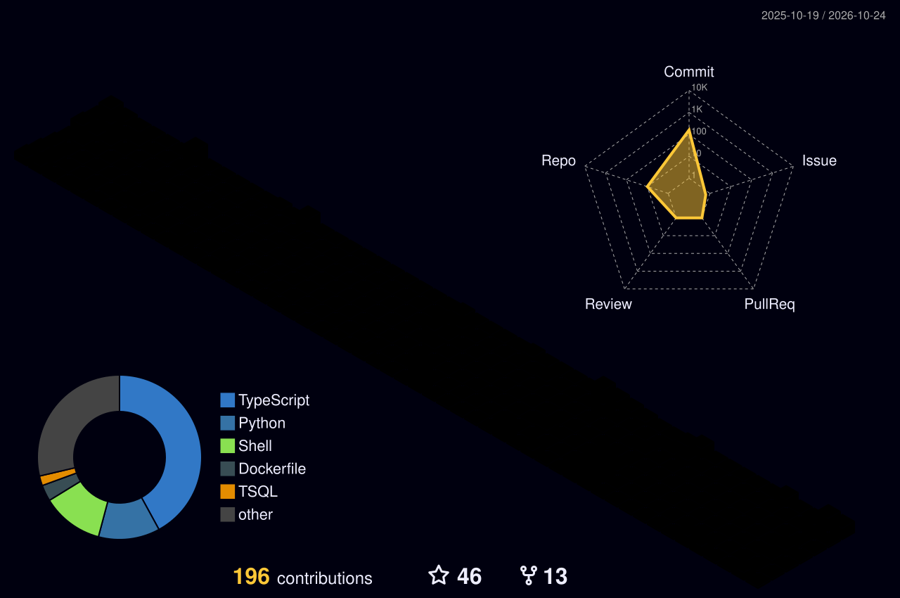

# Hi, I'm Rony 👋

**DevOps & Platform Engineer** | Multi-Cloud (AWS, Azure, GCP) | Kubernetes | GitOps | IaC

---

### About Me

I work on cloud infrastructure, container platforms, and CI/CD pipelines across AWS, Azure, and GCP. My focus is keeping deployments reliable, automated, and secure.

- **Cloud & Containers**: AWS (EKS), Azure (AKS), GCP, and Docker
- **Infrastructure as Code**: Terraform, Azure Bicep, Ansible, and Bash
- **GitOps & Delivery**: ArgoCD, Helm, GitHub Actions, and Jenkins
- **Security & Secrets**: HashiCorp Vault, External Secrets Operator, and Kyverno
- **Observability**: Prometheus, Grafana, OpenTelemetry, and CloudWatch

---

### Tech Stack

  
   
  
   
  

---

### Education & Certification

- **B.Sc. in Computer Science and Engineering**, Khulna University (2018 - 2023)
- **Certified Kubernetes Administrator (CKA)**, The Linux Foundation (2024 - 2026)

---

### Contribution Calendar

  

