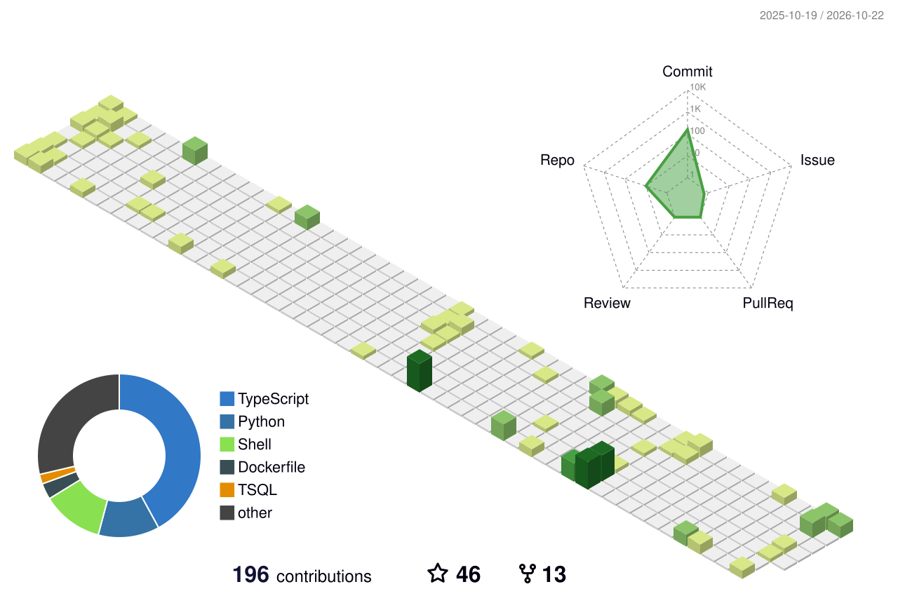

# Hi 👋, I'm Md. Asaduzzaman Rony

**DevOps & Platform Engineer** | Multi-Cloud (AWS, Azure, GCP) | Kubernetes (EKS, OpenShift) | GitOps | IaC | AI Infrastructure

---

### 🚀 About Me

**DevSecOps & Platform Engineer** with 3+ years of experience architecting, automating, and securing multi-cloud platforms across **AWS**, **Microsoft Azure**, and **Google Cloud Platform (GCP)**.

I own the platform layer across enterprise AI platforms, healthcare document extraction pipelines, and high-throughput financial gateways—building the infrastructure, CI/CD, observability, and compliance guardrails that ship workloads reliably and keep them auditable.

- ☁️ **Multi-Cloud & DR**: AWS EKS with cross-region active/standby Disaster Recovery (us-east-1 & us-east-2), Azure AKS (VM-to-AKS migration), and Azure Container Apps.
- ☸️ **Orchestration & Autoscaling**: Kubernetes (EKS, AKS), Red Hat OpenShift, Karpenter just-in-time node provisioning, and KEDA event-driven autoscaling.
- 🛠️ **Infrastructure as Code**: Modular Terraform (VPC, EKS, RDS, APIM, Key Vault, NAT Gateways) and Azure Bicep (AKS, Postgres, Key Vault, ACR, VNets).
- 🔄 **GitOps & Delivery**: ArgoCD App-of-Apps pattern, Kargo environment promotion, Argo Workflows, and in-cluster self-hosted GitHub Actions runners over OIDC.
- 🔐 **DevSecOps & Zero-Trust**: Pipeline SAST/DAST, SBOM generation, Cosign container signing, DefectDojo vulnerability triage, Kyverno admission control, HashiCorp Vault & Azure Key Vault with External Secrets Operator (ESO), default-deny NetworkPolicies, and WireGuard VPN access.
- 📊 **Observability & Reliability**: Full Grafana LGTM stack (Loki, Grafana, Tempo, Mimir/Prometheus) with continuous profiling, Alertmanager to Teams, Fluent Bit to CloudWatch, and Log Analytics (DCE/DCR).
- 🧠 **AI & GPU Infrastructure**: NVIDIA GPU Operator with GPU time-slicing for OCR & LLM workloads, Ollama inference serving, LiteLLM proxy, and MinIO object storage.
- 🛡️ **Compliance & Governance**: Automated evidence collection and control remediation for SOC 2 Type II (TSC Security, Availability, Confidentiality) and ISO 27001 via Drata, alongside HIPAA-aligned healthcare architectures and k6 load testing.

---

### 💻 Tech Stack & Tools

  
   
  
   
  

---

### 📜 Certifications & Education

- 🎓 **B.Sc. in Computer Science and Engineering** — Khulna University (2018 – 2023)
- 🏅 **Certified Kubernetes Administrator (CKA)** — The Linux Foundation

---

### 🧊 3D Contribution Calendar

  <picture>
    <source media="(prefers-color-scheme: dark)" srcset="profile-3d-contrib/profile-night-view.svg">
    <source media="(prefers-color-scheme: light)" srcset="profile-3d-contrib/profile-green-animate.svg">
    
  </picture>

